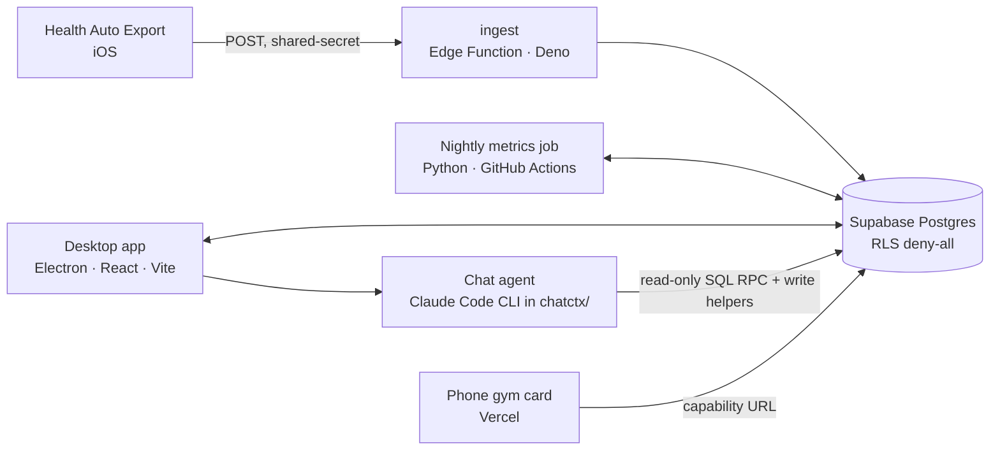

# Alke

A personal performance lab for Apple Watch and Apple Health data. It covers training load,
recovery, aerobic-base (Zone 2) development, gym work and injury rehab, and it has an AI chat
that reasons over the numbers. One person built it and uses it, on one private database.
This repository holds the code, the models and the documentation. The data stays out of it
(see [Privacy design](#privacy-design)).

https://github.com/user-attachments/assets/22ce87d4-00a2-49de-9556-2533cf37cba7

The video shows the app running on a demo database with an invented athlete, not the
owner's data.

## What it does

- **Ingests health data continuously.** The [Health Auto Export](https://github.com/Lybron/health-auto-export)
  iOS app POSTs workouts, heart-rate samples, routes, sleep and daily metrics to a Supabase
  Edge Function. A pure, unit-tested parser normalises each payload. Ingest is idempotent
  under re-delivery: workouts upsert, samples dedupe, daily metrics merge column by column.
  Apple Health's habit of replacing a workout with an edited copy is absorbed rather than
  double-counted.
- **Computes models nightly.** A Python job (GitHub Actions cron) derives:
  - training load (TRIMP, CTL/ATL/TSB, ACWR);
  - recovery;
  - a two-compartment Zone-2 fitness index (a slow-moving durable base plus a fast "sharpness"
    layer, fused from efficiency-factor channels, resting HR, VO₂max and daily activity);
  - goal progress;
  - an N-of-1 insights screen with pre-declared questions, adjustment sets and placebo checks.
- **Shows it in a desktop app.** An Electron + React dashboard with views for sessions,
  Zone 2, recovery, running, walking, cardio HR, gym (templates, set logging, a per-muscle
  fatigue model), injuries (structured recovery plans with symptom-gated phases and adherence
  scoring), insights and a profile. It works offline first, with an optimistic write queue
  that replays on reconnect.
- **Chats over the data.** The app embeds the Claude Code CLI as a chat agent, sandboxed to
  read-only SQL and a set of narrow write helpers. It logs injuries, maintains goals and
  recovery plans, and answers questions with the evidence attached.

Every estimate carries its uncertainty band and its data coverage, and unavailable data shows
an honest empty state. It's informational software, not medical advice.

## Architecture

| Path | Component |
| --- | --- |
| `supabase/` | 60+ SQL migrations; `ingest` and `gymcard` Edge Functions (Deno/TypeScript) |
| `metrics/` | Nightly metrics job and models (Python 3.12, pandas, statsmodels) |
| `app/` | Electron + React + Vite desktop app (TypeScript) |
| `chatctx/` | The chat agent's working directory: helpers, instructions, contracts |
| `gymcard-web/` | Vercel port of the read-only phone gym card |
| `scripts/` | Importers (RunKeeper, blood panels), backfills, the leak gate |
| `docs/` | Model specs and vendor payload docs |

## The models, briefly

- **Zone-2 fitness index.** A slow compartment (detraining time constant 45–90 days) and a
  fast one (about 14 days), driven by weekly aerobic dose. The level comes from separate
  efficiency-factor channels (swim, outdoor ride, run, treadmill, row, indoor power), each
  gated on a baseline the owner ratifies, plus resting HR, VO₂max and a daily-activity floor.
  Every load-bearing constant is a documented literature prior that personalises as history
  grows. Rows are stamped with the model version that produced them.
- **Muscle fatigue.** Per-muscle load from logged sets (with isometric holds given a grounded
  load) and personalised recovery time constants. Full spec in
  [`docs/muscle-fatigue-model.md`](docs/muscle-fatigue-model.md).
- **Insights.** An N-of-1 observational screen built to avoid fishing. Each question declares
  its exposure and outcome timing, population and adjustment set up front, and results go
  through robustness and placebo checks. Contract in
  [`docs/insights-statistical-design.md`](docs/insights-statistical-design.md).

## The chat agent

The desktop app spawns `claude` in `chatctx/` with a sandbox:
- reads only inside the repo;
- no writes to the app code, `.git` or `private/`;
- network limited to the project's Supabase host;
- no MCP servers;
- hooks disabled.

The database is queried through `exec_readonly_sql`, a hardened RPC that accepts SELECT/WITH
only. Writes go through narrow helpers (`injuries.py`, `goals.py`, `gym.py`, `session.py`,
`agent_log.py`) that validate against JSON contracts shared with the app. The agent's
instructions live in `chatctx/modes/`; it reads them through `chatctx/ctx.py`, which applies
the owner's private overrides (below). An `agent_log` table records the agent's own mistakes
and gaps, and those entries drove a long list of fixes visible in the history.

## Privacy design

The data is health data, so the app is built to keep it out of this public repo:
- **Database:** RLS is enabled on every table with no policies, so anonymous and
  authenticated keys get nothing. Access is by the service-role key (server-side only) or by
  the shared-secret Edge Functions. Credentials live in gitignored `.env` files.
- **Private root:** everything personal that isn't in the database (notes, plans, chat
  context, health documents, exports, backups, the training-science library) lives in
  `private/`. That folder is its own private git repo, nested in the checkout and ignored
  here as a whole.
- **Overrides, not generalising:** the repo ships generic chat instructions, and a file in
  `private/chatctx/` replaces or extends its public default.
- **Leak gate:** a versioned pre-push hook (`.githooks/pre-push` → `scripts/leakgate/`) scans
  only what is about to be pushed. Its personal terms are built at run time from the private
  root and the database, never stored here. It also applies generic patterns (keys,
  emails, coordinates, home paths) and reports `sha path:line [category]` without echoing the
  match. CI repeats the generic scan after the push as a backup net.
- **Fixtures:** all test fixtures use invented data.

## Running it

You need your own Supabase project.
1. Apply the migrations with `supabase db push`, then deploy the ingest function with
   `supabase functions deploy ingest` and set its `INGEST_TOKEN` secret.
2. Point Health Auto Export at the function URL with the `x-ingest-token` header.
3. Copy `.env.example` to `.env` (repo root, `app/`, `chatctx/`) and fill in `SUPABASE_URL`
   and `SUPABASE_SERVICE_KEY`.
4. **Metrics:** `pip install -r metrics/requirements.txt && python -m metrics.compute`
   (`--full` recomputes all history).
5. **App:** `cd app && npm install && npm run dev`. The chat tab needs the Claude Code CLI on
   your PATH. `npm run dist:mac` builds an unsigned `.dmg` into `app/release/`. Gatekeeper blocks
   a quarantined copy on first launch: right-click the app and choose Open, or run
   `xattr -cr "Alke.app"`. The packaged build reads its credentials from
   `~/Library/Application Support/health-analytics-app/.env` (same keys as `app/.env.example`).

## Tests

| Suite | Command | Tests |
| --- | --- | --- |
| Metrics models and job | `python -m pytest metrics/tests` | 314 |
| Chat helpers and resolver | `python -m pytest chatctx/tests` | 146 |
| Chat contracts | `node --test chatctx/tests/*.mjs` | 44 |
| Ingest parser | `deno test` in `supabase/functions/ingest` | 85 |
| Gym card renderer | `deno test` in `supabase/functions/gymcard` | 23 |
| Desktop app | `cd app && npm test` (+ `npm run typecheck`, `npm run lint`) | 1,350+ |
| Leak gate | `python -m pytest scripts/leakgate` | 24 |

CI runs these on every push and pull request, plus the generic leak scan.

UI work follows the design system in [`DESIGN.md`](DESIGN.md) and the product principles in
[`PRODUCT.md`](PRODUCT.md).
